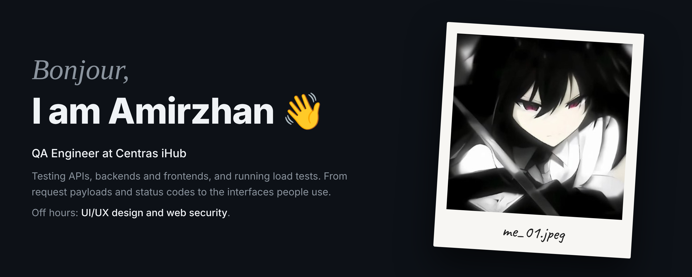

  
  

## 💼 Work

### Centras iHub

QA engineering for web and mobile products: API and backend testing, frontend checks against design, load testing before releases, test cases and bug reports in Jira.

### Also in the open

| Project | About |
|---|---|
| [**fast-switch.lua**](https://github.com/amirzhansar/fast-switch.lua) | Optimizes weapon switching with tickbase control |

## 🧱 Stack

| | |
|---|---|
| **API testing** |    |
| **Load testing** |  |
| **Workflow** |    |
| **Code** |       |
| **Design** |   |
| **Everyday** |       |

Plus UI/UX design and a lot of reading other people's code.

## 📊 A year of code

---

Thanks for stopping by · <a href="https://x.com/amirzhansar">say hi on X</a>

